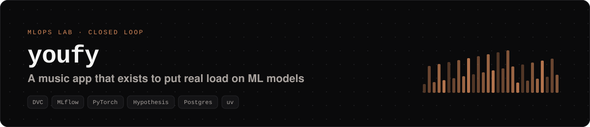
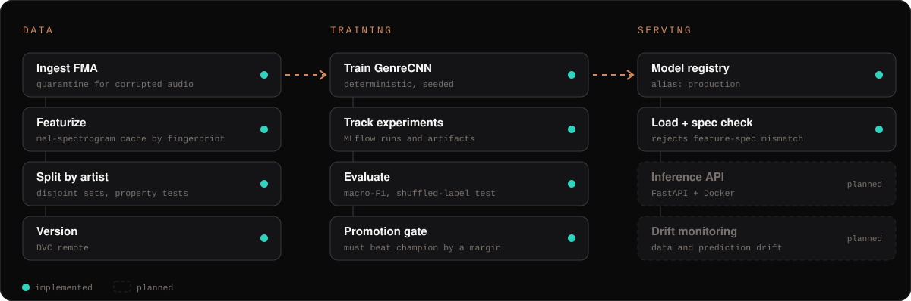

<div align="center">

<picture>
  <source media="(prefers-color-scheme: dark)" srcset="docs/assets/readme/banner-dark.svg">
  <source media="(prefers-color-scheme: light)" srcset="docs/assets/readme/banner-light.svg">
  
</picture>

[](https://github.com/Oseiasdfarias/youfy/actions/workflows/ci.yml)
[](https://oseiasdfarias.github.io/youfy/)


**English** · [Português](README.pt-BR.md)

</div>

## What is Youfy?

Youfy is an **applied AI lab shaped like a music app**. The product exists to give models a real job; the real goal is the **model lifecycle**: reproducible data, tracked training, a promotion rule that only lets better models into production, and serving that refuses inputs it was not trained for.

The first model classifies the **genre** of a music clip from its mel-spectrogram, trained on the open [Free Music Archive](https://github.com/mdeff/fma) benchmark (about 8,000 clips, 8 balanced genres).

## Pipeline

<picture>
  <source media="(prefers-color-scheme: dark)" srcset="docs/assets/readme/pipeline-dark.svg">
  <source media="(prefers-color-scheme: light)" srcset="docs/assets/readme/pipeline-light.svg">
  
</picture>

## What makes it more than a notebook

| Problem | How Youfy handles it |
|---|---|
| **Data leakage between train and test** | Splits are disjoint **by artist**, and the guarantee is checked with property-based tests (Hypothesis). |
| **Training/serving skew** | Mel-spectrograms are cached under the SHA-256 hash of their `FeatureSpec`. Serving loads the model with the spec it expects and **refuses to start** if they differ. |
| **"Is this model really better?"** | A coded **promotion gate**: the first model needs macro-F1 ≥ 0.40; a challenger must beat the champion by a margin, so seed noise cannot replace a good model. |
| **Results nobody can reproduce** | Deterministic, seeded training; a shuffled-label test to catch leakage; every run tracked in **MLflow**; features versioned with **DVC**. |
| **Broken data in the pipeline** | Corrupted audio goes to quarantine during ingestion instead of crashing the run. |

**Status:** data pipeline (phase 1a) and model training, registry and serving loader (phase 1b) are implemented and covered by **109 tests** in CI. Next: an inference API and drift monitoring.

## Quick start

Requirements: Python 3.11+, [uv](https://docs.astral.sh/uv/), Docker and Docker Compose.

```bash
make setup        # install the workspace with a locked environment
make up           # start Postgres
make test         # unit and integration tests
make e2e          # end-to-end data pipeline on a micro dataset
```

Run the pipeline:

```bash
youfy pipeline ingest --dump-dir ./data/raw/fma --subset small   # ingest + quarantine
youfy pipeline featurize --n-mels 128 --hop-length 512           # resumable, cached by fingerprint
youfy pipeline split --seed 42                                   # deterministic, artist-disjoint

make mlflow-up                                                   # MLflow on localhost:5000
youfy pipeline train --epochs 10 --batch-size 32 --seed 42       # tracked run + registered version
youfy pipeline evaluate --version 1 --margin 0.005 --floor 0.40  # promotion gate
```

Load the production model in Python:

```python
from youfy_audio.spec import FeatureSpec
from youfy_serving.loader import load_production

spec = FeatureSpec(sample_rate=22050, n_mels=128, hop_length=512, n_frames=1292)
model = load_production(
    tracking_uri="http://localhost:5000",
    model_name="youfy-genre-cnn",
    expected_spec=spec,  # raises if the model was trained with a different spec
)
```

## Repository layout

```
youfy/
├── packages/
│   ├── audio/      # DSP and mel-spectrogram extraction (pure functions)
│   ├── catalog/    # SQLAlchemy 2.0 models, Alembic migrations, FMA parser
│   ├── ml/         # GenreCNN, deterministic training, evaluation, MLflow tracking, promotion gate
│   └── serving/    # load from the registry with FeatureSpec validation, predictor
├── pipelines/      # Typer CLI `youfy` and offline stages
├── docs/           # MkDocs documentation and engineering specs
└── data/           # features and splits tracked by DVC
```

## Documentation

Full docs, architecture decisions and data contracts: **[oseiasdfarias.github.io/youfy](https://oseiasdfarias.github.io/youfy/)** (in Portuguese).

## Author

Built by **[Oséias Farias](https://github.com/Oseiasdfarias)**, Applied AI & MLOps Engineer.
